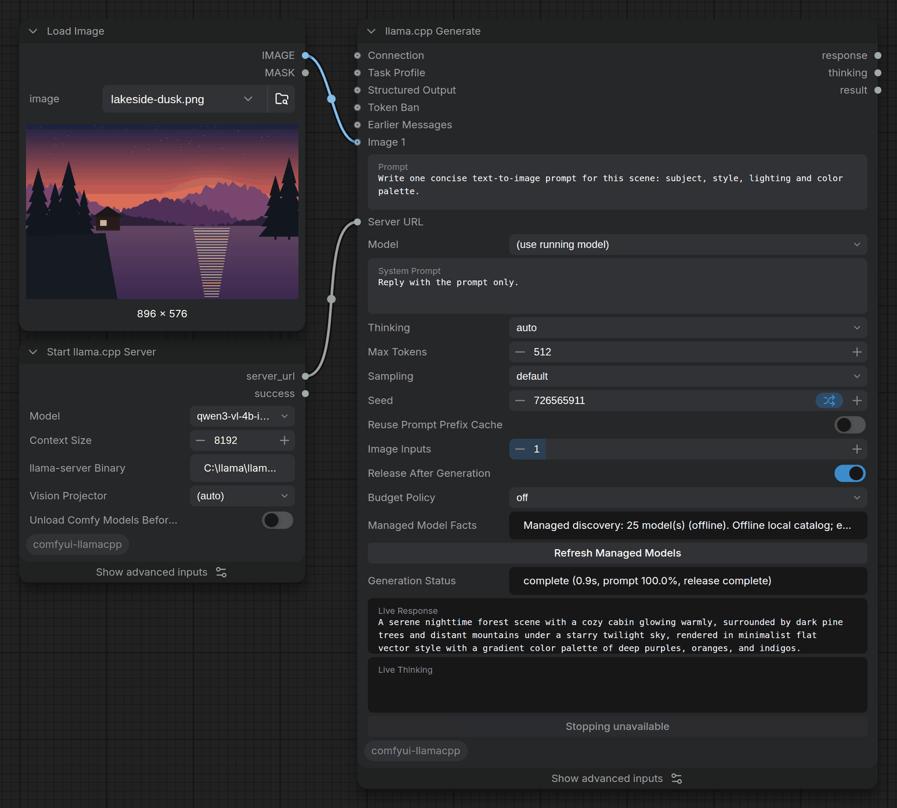

# ComfyUI llama.cpp Suite

Run local GGUF language and vision models in ComfyUI through
[llama.cpp](https://github.com/ggml-org/llama.cpp)'s `llama-server`, with
explicit control over the process that holds the LLM's VRAM.

<p align="center">
  
</p>
<p align="center"><em>A real run: Start llama.cpp Server launches a Qwen3-VL 4B
model, Generate turns the connected image into a text-to-image prompt, then
releases the model so the GPU is free for the next step.</em></p>

The model runs in a separate `llama-server` process, not inside ComfyUI's Python
process. This pack starts that process, tracks exactly what it owns, and releases
it on request, including through ComfyUI's own **Unload Models** action, so an
LLM step and a diffusion step can share one GPU. It never stops a server it did
not start.

No cloud service or cloud API key is required.

## Highlights

- **One recommended node for generation.** **llama.cpp Generate** covers text,
  vision with up to 10 images or a full image batch, JSON / JSON Schema / GBNF
  constraints, token bans and thinking control, with a live preview, a working
  Stop button, strict failure handling and a typed result.
- **Direct or router mode.** Serve one GGUF, or use `llama-server`'s multi-model
  router with exact load and unload barriers and local per-model presets.
- **Owned-process lifecycle.** Only positively owned process trees are stopped,
  with deterministic stop barriers, kernel-backed cleanup on Linux and Job
  Objects on Windows. Processes are never swept by name.
- **GPU handoff in both directions.** Optionally evict ComfyUI's models before
  the LLM starts, then release the LLM afterwards, either automatically after
  generation or with ComfyUI's native unload.
- **Vision projectors matched from metadata.** `(auto)` selects an `mmproj` only
  when local GGUF metadata proves it fits the model, and asks you to choose
  otherwise.
- **Portable, explicit workflows.** Task profiles are copied into the workflow,
  conversation history is passed through graph inputs, and nothing depends on
  hidden server-side state.
- **Batch captions and token budgets.** Caption 1 to 32 images with aligned IDs,
  or count a complete request before generating and optionally refuse one that
  will not fit.
- **Native graph composition.** Result JSON and core ComfyUI text nodes compose
  structured fields, protected literal text and frozen prompts for later renders.
- **Experimental audio.** Short English transcription with one documented
  Qwen3-ASR model pair.
- **Careful with secrets.** API keys come from environment variables and are
  never saved in workflows; remote keys require HTTPS and an explicit allowlist.

This is intentionally not an agent, RAG, MCP, cloud-provider or chat-database
suite. It is a small, dependable local llama.cpp runtime and generation surface.

## Quick start

1. Install the pack: `comfy node install comfyui-llamacpp`, then restart ComfyUI.
2. Make a `llama-server` build available (see [llama.cpp](#llamacpp)).
3. Put at least one GGUF model in `ComfyUI/models/LLM/gguf/`.
4. Open **Workflow > Browse Templates > comfyui-llamacpp > Setup Check** and
   queue it. **llama.cpp Server Status** reports `Setup: ready` when it can run
   `llama-server` and find a model, or explains what is missing.
5. Load the **Quick Text** or **Canonical Text** template, select your model and
   queue it.

[Start Here](docs/start-here.md) walks through the same path in more detail.

## Installation

### Requirements

- ComfyUI on Python 3.10 or newer.
- A current `llama-server` build for your CPU or GPU backend (CUDA, Vulkan,
  ROCm, Metal and others). Optional controls are capability-checked against the
  build before launch. Router mode needs a build that supports `--models-dir`
  and `--models-max`.
- One or more GGUF models.
- Linux only: working `pidfd_open` and `waitid(P_PIDFD)`, normally kernel 5.4 or
  newer. Both are checked before `llama-server` is spawned, with an actionable
  error on an unsupported host.

### From the Comfy Registry

The Registry ID is `comfyui-llamacpp`
([package page](https://registry.comfy.org/nodes/comfyui-llamacpp)):

```bash
comfy node install comfyui-llamacpp
```

Restart ComfyUI afterwards.

### From source

The stable source branch is `master`:

```bash
cd ComfyUI/custom_nodes
git clone --branch master https://github.com/Setmaster/comfyui-llamacpp.git
cd comfyui-llamacpp
```

Install the dependencies with the same Python that launches ComfyUI:

```bash
# ComfyUI virtual environment on Windows
C:\ComfyUI\venv\Scripts\python.exe -m pip install -r requirements.txt

# ComfyUI portable Windows build, adjust the relative path if needed
..\..\..\python_embeded\python.exe -s -m pip install -r requirements.txt

# Linux or macOS virtual environment
python -m pip install -r requirements.txt
```

Restart ComfyUI. The startup log prints the pack version and every registered
llama.cpp node.

### Updating

```bash
cd ComfyUI/custom_nodes/comfyui-llamacpp
git fetch origin
git switch master
git pull --ff-only origin master
python -m pip install -r requirements.txt
```

Saved workflows from earlier releases keep their node IDs, socket names, output
order, defaults and widget positions. Before upgrading important workflows, read
the [migration guides](#upgrading-and-release-history) and the
[CHANGELOG](CHANGELOG.md).

### Following development

Ongoing work lands on `dev`. From a clean source checkout:

```bash
git fetch origin
git switch dev
git pull --ff-only origin dev
python -m pip install -r requirements.txt
```

[Rollback instructions](docs/migration-0.4.md#rollback) return to a published
release.

## llama.cpp

Use an official build from the
[llama.cpp releases](https://github.com/ggml-org/llama.cpp/releases), build it
from source, or install it with your package manager.

On Windows, the official CUDA release comes as two archives: the llama binaries
and the matching CUDA runtime. Extract both into the same, empty directory.
Current releases ship companion DLLs next to `llama-server.exe`, so never copy
only the executable over an older llama.cpp directory. The exact builds used in
validation are recorded in the [validation reports](#upgrading-and-release-history).

The start nodes resolve the executable in this order:

1. The node's **llama-server Binary** (`binary_path`) input.
2. The `LLAMA_SERVER_BINARY` environment variable.
3. The compatibility variable `LLAMA_CPP_SERVER`.
4. `llama-server` or `llama-server.exe` on `PATH`.

An explicit path is clearest when several builds are installed. The pack probes
`--version` and `--help`, records the binary identity, and refuses unsupported
options before spawning anything.

## Models

The default model location is:

```text
ComfyUI/
└── models/
    └── LLM/
        └── gguf/
            ├── model.gguf
            └── vision-model/
                ├── vision-model.gguf
                └── mmproj-vision-model.gguf
```

Roots configured as `LLM` or `llm` in `extra_model_paths.yaml` are also used; if
such a root has a `gguf` child, that child is the model root. Paths go through a
containment-safe catalog, so traversal and symlink escapes are rejected. Files
whose names contain `mmproj` are listed as projectors, separately from models.

### Vision models

**Vision Projector** has three kinds of value:

- `(auto)` reads bounded GGUF header metadata and selects one projector that is
  provably compatible with the model. Filenames and folder adjacency alone never
  count as proof. A text-only model starts without a projector. A known vision
  model with no compatible projector, or with several distinct candidates, fails
  before touching the running server and asks for an explicit choice.
  Equivalent copies across roots are ranked Q8_0, BF16, F16, then F32.
- A projector filename uses that exact file, without substitution.
- `(none - text only)` disables vision deliberately.

Automatic matching recognizes current Gemma 3, Gemma 4, Qwen3-VL and Qwen3.5
layouts and narrowly identified MiniCPM-V layouts. Unknown metadata is never
guessed. The running projector and how it was chosen are shown in **llama.cpp
Server Status**.

In router mode, put each vision model and its projector in their own
subdirectory, or name both paths in a [router preset](docs/router-presets.md).
Never pair a projector from a different model size or architecture.

## Building workflows

### Templates

ComfyUI lists the bundled workflows under **Workflow > Browse Templates >
comfyui-llamacpp**. After loading one, select models and projectors that exist
on your machine, and set **llama-server Binary** if Setup Check could not find
it.

| Template | What it shows |
| --- | --- |
| `setup-check` | Binary, device, model-root and projector readiness, without starting a server. |
| `quick-text` | The smallest path: Start Server, Basic Prompt, Prompt Output. |
| `canonical-text` | Recommended text generation with a portable profile, strict errors, live status and release. |
| `canonical-vlm-image-understanding` | One image into Generate for factual image understanding. |
| `canonical-structured-json` | Strict JSON Schema output validated as JSON. |
| `canonical-app-mode` | A compact App Mode surface with live status and response. |
| `graph-structured-field` | Read one generated JSON field with core nodes. |
| `graph-protected-literal-draft` | Append exact literal text after generation. |
| `graph-frozen-render` | Render a reviewed, saved prompt without any LLM request. |
| `messages-few-shot` | Explicit few-shot history, then draft and refine. |
| `caption-batch-aligned` | Independent, aligned captions for several images. |
| `direct-text`, `router-text` | Direct and router lifecycles end to end. |
| `vlm-image-to-prompt`, `structured-output` | Image-to-prompt and JSON Schema with ADV++. |
| `vram-handoff` | Evict ComfyUI models before the LLM, then release it. |

The [workflow guide](example_workflows/README.md) describes each one and its
limits.

### Generate

For new workflows, use **llama.cpp Generate**:

1. Add **Start llama.cpp Server** and select a GGUF.
2. Connect its `server_url` output to Generate's **Server URL** input, or leave
   Server URL empty to use the currently managed server. (Server URL is an
   advanced input; older frontends need it converted from a widget first.)
3. Enter a prompt. Leave **Thinking** on `auto` and **Sampling** on `default`
   unless the model or task needs an override.
4. Optionally connect images, **Structured Output**, **Token Ban**, a **Task
   Profile** or **Earlier Messages**.
5. Queue. Generate shows live response and thinking text, and returns
   `response`, `thinking` and a typed `result`.

A **llama.cpp Connection** can be connected instead of Server URL; supplying both
is rejected before generation. Turn on **Release After Generation** to free the
model once the result is final. See [Canonical Generate](docs/canonical-generate.md)
for profiles, cancellation, discovery and strict-failure behavior.

### Router mode

1. Add **Start llama.cpp Router**. Leave `models_directory` on `(auto)` or pick
   the root to expose, or select a [local router preset](docs/router-presets.md)
   for named paths and per-model settings.
2. Optionally sequence **llama.cpp Load Model** from its `success` output.
3. Choose the model on the generation node and queue.
4. Use **llama.cpp Unload Model** for one model, or **Release llama.cpp VRAM**
   for every resident model.

Load and unload return only after `/models` reports the requested state; an
accepted HTTP request alone is not treated as done. **llama.cpp List Models** is
the authoritative router catalog. In directory discovery, root-level GGUFs are
separate models, each immediate subdirectory is one model bundle with one base
model and at most one projector, and deeper directories are not visible.
Direct-mode dropdowns, by contrast, search all configured roots recursively.

Generate checks the router's own metadata against the full resolved model path,
so a matching basename in another folder is never accepted as the same model.
Keep one base GGUF per bundle for portable router layouts; the details are in
[Canonical Generate](docs/canonical-generate.md).

### Attaching to an existing server

Point Server URL at it or create a **llama.cpp Connection** profile. A server
this pack did not start is treated as external: native unload and implicit
lifecycle actions never stop or unload it.

## VRAM and lifecycle

ComfyUI has no general unloader for external runtimes, so this pack hooks
successful `POST /free` and `POST /api/free` calls into its own lifecycle
coordinator.

| Action | Owned direct server | Owned router | Attached server |
| --- | --- | --- | --- |
| ComfyUI **Unload Models** | Stops the owned process tree | Unloads resident models; keeps the router when barriers succeed | No action |
| **Release llama.cpp VRAM** | Stops the owned process tree | Unloads all resident models | No action |
| **llama.cpp Unload Model** | Not applicable | Unloads one model to a terminal state | Not used for ownership |
| **Stop llama.cpp Server** | Stops the process tree | Stops the router process tree | Not targeted |

- A release requested during generation waits until the last active generation
  finishes; concurrent requests are coordinated.
- Direct release completes only when the owned process tree is gone. Router
  release completes only when every target is nonresident; if no trustworthy
  router barrier exists, the owned router is stopped instead.
- The Release node's Boolean means the request was accepted. Check its status or
  `terminal` field before assuming VRAM is free: `deferred` and `coalesced` are
  accepted but not yet finished.
- `unload_comfy_models_before_start` on either start node asks ComfyUI to evict
  its models and empty its cache before llama.cpp allocates GPU memory. It is
  off by default because it changes residency for the rest of the workflow.

[Lifecycle and VRAM ownership](docs/lifecycle.md) has the full contract.

## Nodes

Nodes appear under `LlamaCpp/Runtime`, `LlamaCpp/Router`, `LlamaCpp/Generate`
and `LlamaCpp/Utilities`, and can be found with everyday search terms such as
GGUF, VLM, prompt enhancer, JSON Schema or free VRAM. Dense nodes show their main
controls first; **Show advanced inputs** reveals the rest.

**Runtime**

| Node | Purpose |
| --- | --- |
| Start llama.cpp Server | Start one owned direct server for a single GGUF. |
| Stop llama.cpp Server | Stop the owned direct server or router. |
| Release llama.cpp VRAM | Free direct or router model VRAM, keeping the router when safe. |
| llama.cpp Server Status | Setup check plus mode, ownership, process state, capabilities, errors and a redacted log tail. |
| llama.cpp Connection | Reusable URL, model, API-key variable name, TLS policy and deadline. |

**Router**

| Node | Purpose |
| --- | --- |
| Start llama.cpp Router | Start one owned multi-model router. |
| llama.cpp List Models | List router models and their residency, optionally rescanning. |
| llama.cpp Load Model | Load one model and wait until it can be called. |
| llama.cpp Unload Model | Unload one model and wait until it is nonresident. |

**Generate**

| Node | Purpose |
| --- | --- |
| llama.cpp Generate | Recommended text, vision and constrained generation with live state and a typed result. |
| llama.cpp Task Profile | Manage your profile library and save a portable snapshot into the workflow. |
| llama.cpp Append Message | Append one exact text turn to an explicit history. |
| llama.cpp Messages from JSON | Import a bounded, portable text history. |
| llama.cpp Request Budget | Count the complete request without generating; report or enforce context room. |
| llama.cpp Caption Batch | One independent caption per image, with aligned IDs and one cleanup. |
| llama.cpp Transcribe (Experimental) | Transcribe one short English audio clip with the supported Qwen3-ASR pair. |
| llama.cpp Basic Prompt | Text generation with common sampling controls. |
| llama.cpp ADV Prompt | Text plus 0 to 10 image inputs and optional full image batches. |
| llama.cpp ADV++ Prompt | ADV plus prompt templates, token bans and structured output. |

Basic, ADV and ADV++ remain fully supported for existing workflows; Generate is
the better starting point for new ones.

**Utilities**

| Node | Purpose |
| --- | --- |
| llama.cpp Prompt Output | Preview and pass through text, optionally stripping common markup. |
| llama.cpp Result JSON | Serialize Generate's full typed result, including errors and release evidence. |
| llama.cpp Structured Output | Build JSON object, JSON Schema or GBNF constraints. |
| llama.cpp Token Ban | Build text-form logit-bias entries. |
| llama.cpp Token Count | Tokenize text through `/tokenize` with model-aware routing. |
| llama.cpp Model Info | Read `/props`: model name, context length and raw properties. |

## Generation behavior

- **Completion is explicit.** A generation succeeds only after a valid stream
  terminal marker. Partial text from a timeout, cancellation or broken stream is
  kept and labelled. Generate raises on total failure and, by default, on
  partial output; only `return_marked_partial` passes partial text through, and
  the result still marks it incomplete.
- **Defaults stay the model's.** Generate's `default` sampling sends no sampler
  settings at all, so the model and server keep their own defaults; `custom`
  sends every displayed sampler together. Thinking `auto` likewise sends no
  override.
- **Budgets never rewrite input.** [Budget Policy](docs/request-budget.md) is off
  by default. `report` records the count; `enforce` requires known input and
  context sizes plus room for the requested output. Nothing is truncated or
  summarized.
- **`keep_context` is a cache, not memory.** It maps to llama.cpp
  `cache_prompt` and reuses a matching prompt prefix. Use the
  [message nodes](docs/messages.md) for real conversation history.
- **Images.** `image_amount` accepts 0 to 10, and all ten sockets always exist so
  saved workflows survive a reload. `include_image_batch` sends every image in a
  connected batch in one request; off keeps the first-image behavior.
  [Caption Batch](docs/captions.md) sends one request per image instead.
- **Lists.** Stop sequences and token bans accept one entry per line, a JSON
  string array, or comma-separated values. Use JSON when commas or surrounding
  spaces matter.
- **Ordering.** A connected `trigger` socket sequences nodes; `enable_chaining`
  remains only for saved-workflow compatibility.

### ADV++ prompt templates

ADV++ templates such as `Image2Prompt` and `Prompt Enhancer` live in
[`web/templates.json`](web/templates.json):

```json
{
  "My Template": {
    "system_prompt": "Your system instruction",
    "prompt": "Optional default user prompt"
  }
}
```

Templates are applied in Python as well as in the UI, so API and headless runs
behave the same. Choosing a template only fills fields that are exactly empty;
it never overwrites a draft. Use the explicit replace/reset action to overwrite
both fields (it supports undo). Restart ComfyUI after editing the file. For
Generate, use [task profiles](docs/task-profile-authoring.md) instead.

## Authentication, TLS and network exposure

Secrets are read from environment variables and never saved in workflows. The
default variable is `LLAMACPP_API_KEY`:

```bash
# Linux or macOS
export LLAMACPP_API_KEY='your-local-key'

# Windows PowerShell, before launching ComfyUI
$env:LLAMACPP_API_KEY = 'your-local-key'
```

Generate accepts only `LLAMACPP_API_KEY` or a namespaced
`LLAMACPP_API_KEY_<UPPERCASE_SUFFIX>` name from a workflow. When that variable
holds a key, plain HTTP is allowed only for loopback hosts. A non-loopback server
requires HTTPS, certificate verification and an exact origin-to-key allowlist
that a workflow cannot change:

```bash
# Linux or macOS
export LLAMACPP_API_KEY_LAN='your-remote-key'
export LLAMACPP_REMOTE_AUTH_BINDINGS='{"https://llm.example.test:443":"LLAMACPP_API_KEY_LAN"}'

# Windows PowerShell, before launching ComfyUI
$env:LLAMACPP_API_KEY_LAN = 'your-remote-key'
$env:LLAMACPP_REMOTE_AUTH_BINDINGS = '{"https://llm.example.test:443":"LLAMACPP_API_KEY_LAN"}'
```

Each key is an exact `scheme://host:port` origin and each value the one variable
allowed for it. This stops an imported workflow from picking an unrelated secret,
sending a key over cleartext LAN traffic, or redirecting it to another host.
Earlier prompt nodes keep their original authentication behavior.

For an owned server, point `api_key_file` at the llama.cpp key file and set
`api_key_env` to the variable holding the matching client key. Connection and
prompt nodes also expose `verify_tls` and an overall request deadline. Commands,
status output and server logs redact configured secrets and common
credential-shaped fields.

The pack's status, release, profile, discovery, live-update and cancellation
routes share ComfyUI's own network trust boundary and add no authentication of
their own. Status can reveal local paths and a redacted log tail, and release can
stop the owned runtime. Keep ComfyUI on loopback, or behind authentication you
control, unless the network is trusted.

## Troubleshooting

Start with **llama.cpp Server Status**: it shows the resolved binary identity,
ownership mode, lifecycle state, pending releases and a redacted log tail. Then
see [Troubleshooting](docs/troubleshooting.md).

## Documentation

**Guides**

- [Start Here](docs/start-here.md)
- [Canonical Generate](docs/canonical-generate.md)
- [Compose generation with native ComfyUI nodes](docs/graph-composition.md)
- [Local router presets](docs/router-presets.md)
- [Explicit text messages](docs/messages.md)
- [Complete-request budgeting](docs/request-budget.md)
- [Independent image captions](docs/captions.md)
- [Task profile authoring](docs/task-profile-authoring.md)
- [Experimental audio transcription](docs/audio-transcription.md)
- [Lifecycle and VRAM ownership](docs/lifecycle.md)
- [Troubleshooting](docs/troubleshooting.md)
- [Example workflows](example_workflows/README.md)

### Upgrading and release history

- [CHANGELOG](CHANGELOG.md) and
  [GitHub releases](https://github.com/Setmaster/comfyui-llamacpp/releases)
- Migration guides: [0.2.1 to 0.3](docs/migration-0.3.md),
  [after 0.3](docs/migration-0.4.md)
- User acceptance checklists: [0.3](docs/user-acceptance.md),
  [canonical Generate](docs/user-acceptance-0.4.md)
- Validation reports: [0.3](docs/validation-0.3.md),
  [canonical Generate](docs/validation-0.4.md),
  [October candidate](docs/validation-2026-10.md),
  [October backlog](docs/validation-2026-10-backlog.md),
  [October features](docs/validation-2026-10-features.md),
  [current Windows runtime](docs/validation-2026-10-21.md)
- [Research and ecosystem analysis](docs/research/)

## Development

```bash
uv sync --locked --extra dev
uv run --locked python -m pytest -q
uv run --locked ruff check .
uv run --locked ruff format --check .
node --test tests/js/*.test.mjs
for file in web/*.js; do node --check "$file"; done
uv build
uv run --locked python tests/check_distribution.py dist
uv run --locked python tests/smoke_distribution.py dist --prove-rejection
git diff --check
```

The suite pins every released node and widget contract, replays historical
workflow fixtures, and covers router and client contracts, lifecycle races,
Generate request/result/profile round trips, release coordination, stream
cleanup, process trees, frontend helpers and package builds. CI runs Python 3.10
to 3.14 on Linux and Python 3.13 on Windows. Real ComfyUI, llama.cpp, Windows
Job Object, vision and GPU handoff evidence is recorded in the validation
reports.

[CODEBASE_MAP.md](CODEBASE_MAP.md) explains the module layout.

## License

[MIT](LICENSE)
